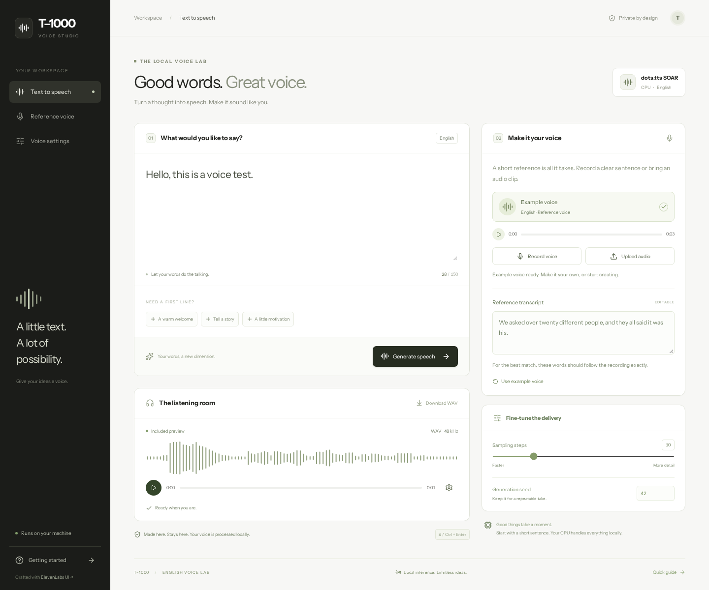
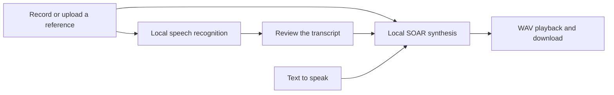

<a id="readme-top"></a>

<div align="center">

<picture>
  
</picture>

# T-1000

**Local speech generation and voice cloning, built with ElevenLabs UI.**


[Quick start](#quick-start) · [Usage](#usage) · [Documentation](#documentation) · [Contributing](#contributing)

</div>

<br/>

<p align="center">
  
</p>

> [!NOTE]
> Early development. The interface currently supports English. CPU inference has been exercised locally; real GPU validation is still pending. See the [changelog](CHANGELOG.md).

## Overview

T-1000 is a local voice studio for experimenting with English speech synthesis and voice cloning. It combines the [dots.tts SOAR](https://huggingface.co/dots-studio/dots.tts-soar) model with a React interface, automatic reference transcription, and WAV playback. After downloading the models, generation and recognition run on your machine without an ElevenLabs account or API key.

### Features

- **Clone a reference voice.** Record or upload a clear sentence, review its transcript, and generate new speech in that voice.
- **See words while recording.** The default CPU recognizer processes incoming audio incrementally; the complete recording is retained for finalization.
- **Listen and save.** Preview references and generated audio, seek through playback, change playback speed, and download a WAV.
- **Choose your hardware.** Use CPU inference or install the CUDA profile; CPU recognition can leave GPU memory available for synthesis.
- **Control long requests.** Track generation progress, stop after the current audio step, and retain any partial output.

## Requirements

| Requirement | Details |
| :--- | :--- |
| **OS** | Linux is the tested CPU environment. GPU setup is documented for Linux or WSL2. |
| **Python** | Python 3.11 and [uv](https://docs.astral.sh/uv/). |
| **Frontend** | Node.js 20.19+ on the 20.x line, or 22.12+; npm. |
| **System tools** | Git, FFmpeg, and libsndfile. |
| **Browser** | A current browser with AudioWorklet; microphone access requires localhost or HTTPS. |
| **Storage** | About 5.2 GB for SOAR and 662 MB for the CPU recognizer, plus dependencies and caches. |
| **Optional GPU** | NVIDIA CUDA with a compatible PyTorch build; BF16 where supported, otherwise FP16. Minimum VRAM has not been verified; see [setup](docs/setup.md). |

## Installation

### Docker

Choose one setup; each builds the UI, downloads the pinned models into persistent
volumes, loads inference, and starts the studio at **http://localhost:7860**.

CPU:

```bash
docker compose -f compose.cpu.yaml up --build -d
```

NVIDIA GPU, with a compatible driver and NVIDIA Container Toolkit:

```bash
docker compose -f compose.gpu.yaml up --build -d
```

The first launch downloads about 5.2 GB of SOAR weights plus the CPU speech
recognizer. See the [Docker guide](docs/docker.md) for logs, volume reuse,
GPU requirements and low-memory profiles. Docker installations do not need
Python or Node.js on the host.

### Local installation

Run these commands from a new checkout to install the default CPU profile:

```bash
git clone https://github.com/TheCoalitionOfPlanets/T-1000.git
cd T-1000

uv venv --python 3.11 .venv
UV_CACHE_DIR="$PWD/.cache/uv" uv pip install --python .venv/bin/python \
  --torch-backend cpu --requirements requirements/cpu.txt -e apps/api

UV_CACHE_DIR="$PWD/.cache/uv" HF_HOME="$PWD/.cache/huggingface" \
  HF_HUB_OFFLINE=0 HF_HUB_DISABLE_XET=1 \
  uvx --from huggingface-hub hf download dots-studio/dots.tts-soar \
  --revision 2f9b3e18d70d670d4c701da2dc55ded5755815ce \
  --local-dir data/models/dots.tts-soar

.venv/bin/python scripts/fetch_stt.py
npm ci
npm run build
```

Install the complete model snapshot. The inference runtime is pinned to commit `b65ca7149fb43b8fb8d52916aa12738deda7b188`; shared dependency pins live in [requirements/constraints.txt](requirements/constraints.txt). Installing `apps/api` alone does not install the runtime dependencies.

<details>
<summary><b>NVIDIA CUDA setup</b></summary>

<br/>

Follow the [GPU setup guide](docs/setup.md) for driver checks, the CUDA PyTorch profile, model downloads, and a receiving-machine smoke test. Its install command uses `requirements/gpu.txt` instead of the CPU profile. Optional CUDA recognition adds `requirements/stt-gpu.txt` and the model fetched by `scripts/fetch_whisper.py`.

</details>

### Updating

For an existing CPU installation, stop the server and run:

```bash
git pull --ff-only
UV_CACHE_DIR="$PWD/.cache/uv" uv pip install --python .venv/bin/python \
  --torch-backend cpu --requirements requirements/cpu.txt -e apps/api
npm ci
npm run build
```

For a CUDA installation, use the GPU dependency commands in the [setup guide](docs/setup.md). Model weights and generated recordings are excluded from Git and remain in their local directories when updating.

## Quick start

```bash
.venv/bin/python -m t1000  # serve the built studio at http://127.0.0.1:7860
```

1. Open **http://127.0.0.1:7860** and keep the preloaded example voice.
2. Enter a short sentence, such as “Hello, this is a voice test.”
3. Click **Generate speech**, then play or download the result.

The first generation also loads the speech model. CPU synthesis can take several minutes; start with one short sentence.

## Usage

To use your own voice, click **Record voice**, speak a clear 3–6 second sentence, and click **Finish recording**. You can also choose **Upload audio**. Review the editable **Reference transcript** so its words match the recording exactly, then generate your new text. **Use example voice** restores the bundled reference and matching transcript.

**Stop generation** requests cancellation after the current audio step. If audio has already been produced, it is saved as partial output. If automatic transcription fails, a valid recording remains available so you can enter its words manually.

### Commands

| Command | Description |
| :--- | :--- |
| `.venv/bin/python -m t1000` | Start the API and built web interface on port 7860. |
| `.venv/bin/python -m t1000.ui` | Start the optional Gradio interface on the same port; run one interface at a time. |
| `.venv/bin/python scripts/fetch_stt.py` | Download and verify the pinned CPU recognition model. |
| `.venv/bin/python scripts/fetch_whisper.py` | Download the pinned optional CUDA recognition model. |
| `npm run dev` | Start Vite with an API proxy to port 7860. |
| `npm run build` | Type-check and build the web app into `apps/web/dist`. |

### Keybindings

| Key | Action |
| :--- | :--- |
| `Ctrl` + `Enter` / `Cmd` + `Enter` | Generate speech when the reference and text are ready. |

## Configuration

Generation settings are available in the interface; there is no application settings file.

| Setting | Default | Range |
| :--- | :--- | :--- |
| Sampling steps | `10` | `4`–`32`; more steps take longer. |
| Generation seed | `42` | Whole numbers from `0` to `4294967295`. |

### Speech recognition: CPU and gaming GPU profiles

| Profile | Recognition | Synthesis |
| :--- | :--- | :--- |
| CPU | Nemotron English 0.6B INT8 with sherpa-onnx; `STT_BACKEND=cpu`. | CPU PyTorch. |
| Gaming GPU default | The same CPU streaming recognizer, leaving CUDA memory for synthesis. | CUDA PyTorch from `requirements/gpu.txt`. |
| Optional CUDA recognition | Distil-Whisper large-v3.5 with faster-whisper; `STT_BACKEND=cuda`. | CUDA PyTorch; additional VRAM is needed. |

Nemotron consumes each audio chunk once. The optional Whisper backend makes buffered previews and rechecks the complete recording when you finish. CUDA recognition and synthesis share a compute lock; recognition weights are released after final transcription and before synthesis. See the [setup guide](docs/setup.md) for downloads and CUDA libraries.

### Environment variables

| Variable | Effect |
| :--- | :--- |
| `STT_BACKEND` | `cpu` by default; set `cuda` for optional CUDA recognition. This does not select the synthesis device. |
| `STT_NUM_THREADS` | CPU recognizer threads; defaults to the smaller of four and the CPU count. Must be positive. |
| `STT_MODEL_DIR` | Override the CPU recognition model directory under `data/models`. |
| `STT_GPU_MODEL_DIR` | Override the CUDA recognition model directory under `data/models`. |
| `T1000_ROOT` | Override the runtime root when using the Python package outside its checkout. |
| `T1000_TTS_PROFILE` | `auto` by default: experimental `low-vram` on CUDA GPUs with 6 GiB or less; otherwise `standard`. Set `offload` for CPU-backed language-model layers. |
| `T1000_TTS_OPTIMIZE` | `auto` by default: compile standard CUDA inference on GPUs with at least 12 GiB. `0` disables compilation; `1` explicitly enables it in the standard profile. Low-memory profiles stay eager. |
| `T1000_TTS_GPU_LAYERS` | Offload profile only: number of Qwen blocks kept on GPU, default `0`. `14` keeps half its 28 decoder blocks resident, with a higher VRAM cost. |
| `HF_HUB_OFFLINE` | Defaults to `1` in the app; explicit Hugging Face download commands use `0`. |
| `GRADIO_ANALYTICS_ENABLED` | Defaults to `False`. |

### Files it creates

| Path | Contents |
| :--- | :--- |
| `data/models/` | Downloaded synthesis and recognition weights. |
| `data/output/` | Generated WAV files, including any saved partial audio. |
| `.cache/recordings/` | Complete microphone reference WAVs. |
| `.cache/ui-references/` | Uploaded references normalized for the web interface. |
| `.cache/requests/` | Temporary frozen references for synthesis; removed when the worker finishes. |
| `.cache/uv/`, `.cache/huggingface/`, `.cache/stt/` | Dependency and model download caches. |
| `.venv/`, `node_modules/`, `apps/web/dist/` | The Python environment, npm dependencies, and built interface. |

These runtime directories are ignored by Git. The Gradio fallback can also copy audio into its system temporary cache.

The experimental 4–6 GB profiles need [additional dependencies](requirements/gpu-low-vram.txt).
They offer NF4 language-model quantization or CPU layer offload while retaining
SOAR's reference conditioning and acoustic modules. Fit, speed and voice fidelity
still require a real GPU test. Standard compiled inference includes an initial
warmup; subsequent requests reuse the loaded runtime. See
[GPU inference performance](docs/setup.md#gpu-inference-performance) for setup and
comparison commands that measure generation time and save audio for listening.

## Privacy and safety

- Setup downloads packages and model files from external services. Inference uses local model weights.
- No ElevenLabs API key or hosted inference service is used. Gradio analytics are disabled by default.
- Completed reference recordings and generated speech can remain on disk after a browser session. Remove saved files when they are no longer needed.
- The server binds to `127.0.0.1`. Recordings included in screenshots, issues, or attachments are shared by you, so use the bundled example when reporting bugs.

## How it works



The browser sends microphone PCM in order and keeps the complete recording separately from live transcription requests. The FastAPI backend validates the reference, transcribes it, and passes the reviewed words and new text to SOAR. The bundled example skips transcription because its matching words are already supplied. Generated audio is saved under `data/output` and served back to the player.

## Tech stack

| Component | Tool |
| :--- | :--- |
| **Speech synthesis** | [dots.tts SOAR](https://huggingface.co/dots-studio/dots.tts-soar), [dots.tts runtime](https://github.com/studio-dots-ai/dots.tts), and [PyTorch](https://pytorch.org/). |
| **CPU recognition** | [Nemotron Speech](https://huggingface.co/nvidia/nemotron-speech-streaming-en-0.6b) through [sherpa-onnx](https://github.com/k2-fsa/sherpa-onnx). |
| **Optional CUDA recognition** | [Distil-Whisper](https://huggingface.co/distil-whisper/distil-large-v3.5) through [faster-whisper](https://github.com/SYSTRAN/faster-whisper). |
| **Web interface** | [React](https://react.dev/), [Vite](https://vite.dev/), [Tailwind CSS](https://tailwindcss.com/), and [ElevenLabs UI](https://github.com/elevenlabs/ui). |
| **API and fallback interface** | [FastAPI](https://fastapi.tiangolo.com/), [Uvicorn](https://www.uvicorn.org/), and [Gradio](https://www.gradio.app/). |
| **Browser tests** | [Playwright](https://playwright.dev/). |

## Project structure

```text
.
├── apps/
│   ├── api/
│   │   ├── src/t1000/   # API, synthesis, recognition, and microphone transport
│   │   └── tests/       # Python regression tests
│   └── web/             # React interface and browser tests
├── assets/              # Bundled reference audio and attribution
├── data/                # Local models and generated audio; ignored by Git
├── docs/                # Setup guide, research, and README visuals
├── requirements/        # Shared pins and CPU/CUDA profiles
├── scripts/             # Model download tools
├── package.json         # Root npm workspace commands
└── README.md
```

Keep directories lowercase, Python modules in `snake_case`, and documents in `kebab-case`. Preserve standard filenames and the conventions used by React and vendored components. The npm workspace has one root lockfile; Python uses an editable `src` package with runtime paths defined in `t1000.paths`.

## Development

Complete [installation](#installation) first. Run the API and Vite in separate terminals:

```bash
.venv/bin/python -m t1000  # terminal 1: local API
npm run dev               # terminal 2: web app with API proxy
```

With the API running, verify changes from the repository root:

```bash
.venv/bin/python -m unittest discover -s apps/api/tests -v
npm run build
npm exec --workspace @t1000/web -- playwright install chromium
npm run test:web
git diff --check
```

The suite currently contains 109 Python tests and six browser checks. Full speech inference is mocked in regression tests; optional bitsandbytes and Accelerate tests exercise small real Qwen models. Browser checks exercise the real microphone worklet with a test clip. For another API port, set `PLAYWRIGHT_BASE_URL`, for example `http://127.0.0.1:7861`.

## Troubleshooting

<details>
<summary><b>The interface says its build is missing</b></summary>

<br/>

Build the web workspace before starting the Python server:

```bash
npm ci
npm run build
.venv/bin/python -m t1000
```

</details>

<details>
<summary><b>Python cannot import t1000</b></summary>

<br/>

Register the editable package in the environment that already contains the runtime dependencies:

```bash
uv pip install --python .venv/bin/python --no-deps -e apps/api
```

</details>

<details>
<summary><b>Recording works but automatic transcription is unavailable</b></summary>

<br/>

Read the transcription status for the missing dependency or weight file. For the default CPU profile, fetch the verified recognition model:

```bash
.venv/bin/python scripts/fetch_stt.py
```

A valid recording can still be used by entering its exact words manually. CUDA recognition setup and library errors are covered in the [setup guide](docs/setup.md).

</details>

<details>
<summary><b>Generation is slow or the result sounds wrong</b></summary>

<br/>

Try the bundled voice and one short English sentence. Check that your own reference is audible and its transcript matches exactly. CPU inference can take several minutes; **Stop generation** finishes the current audio step before returning. CUDA checks and memory troubleshooting are in the [setup guide](docs/setup.md).

</details>

## Limitations

- This interface supports English inference; training and fine-tuning are not implemented.
- CPU requests allow 150 text characters and references up to 10 seconds. Standard CUDA requests allow 500 characters and 30-second references; experimental low-memory profiles allow 150 characters and 6-second references. References must be at least one second; uploads are capped at 32 MB.
- Generation has a 600-second budget. Cancellation waits for the current compute step.
- Real GPU synthesis, combined TTS/ASR memory use, and minimum VRAM remain unverified on the receiving machine.
- The previous CPU smoke run produced 1.92 seconds of audio in about 94 seconds, including model loading, on an Intel Core Ultra 9 185H. This is one sample, not a performance benchmark.

## Documentation

| Guide | What's in it |
| :--- | :--- |
| [Setup](docs/setup.md) | GPU installation, pinned downloads, verification, and troubleshooting. |
| [Docker](docs/docker.md) | Separate CPU/GPU builds, automatic model setup, persistent volumes, and container benchmarks. |
| [Changelog](CHANGELOG.md) | Implementation changes and validation records. |
| [Reference audio](assets/README.md) | Bundled clip provenance and its exact transcript. |
| [Third-party notices](apps/web/NOTICE.md) | UI component and font sources and licenses. |
| [Dataset survey](docs/datasets.pdf) | Background research on speech datasets. |
| [Voice cloning study](docs/voice-cloning.pdf) | Background research on voice conversion and cloning. |

## Contributing

[Issues](https://github.com/TheCoalitionOfPlanets/T-1000/issues) and pull requests are welcome. Include your OS, CPU or GPU, dependency versions, steps to reproduce, and relevant logs. Use the example voice for reproducible reports and run the development checks before submitting changes.

## Security

The server is intended for local use and does not implement authentication. There is no dedicated security reporting policy yet; avoid publishing credentials, private recordings, or sensitive exploit details in public issues.

## License

A repository-wide license has not been added. Bundled third-party code and assets retain their own terms:

- ElevenLabs UI components: MIT; see [the included license](apps/web/src/components/elevenlabs/LICENSE.md).
- Instrument Sans: SIL Open Font License 1.1; see [the included font license](apps/web/public/fonts/InstrumentSans-OFL.txt).
- SOAR model: Apache 2.0 as declared by its [upstream model card](https://huggingface.co/dots-studio/dots.tts-soar).
- Reference clip: source and attribution in [assets/README.md](assets/README.md).

## Acknowledgements

- [dots studio](https://github.com/studio-dots-ai/dots.tts) for the synthesis model and runtime.
- [NVIDIA](https://huggingface.co/nvidia/nemotron-speech-streaming-en-0.6b) and [sherpa-onnx](https://github.com/k2-fsa/sherpa-onnx) for CPU speech recognition.
- [ElevenLabs UI](https://github.com/elevenlabs/ui) for the audio player and live waveform components.
- [Seed-TTS-Eval mini](https://huggingface.co/datasets/zhaochenyang20/seed-tts-eval-mini) for the public reference clip.

<br/>

<div align="center">
  <sub>Built by <a href="https://github.com/TheCoalitionOfPlanets">TheCoalitionOfPlanets</a> · <a href="#readme-top">Back to top</a></sub>
</div>
